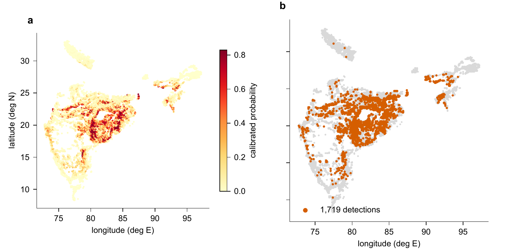
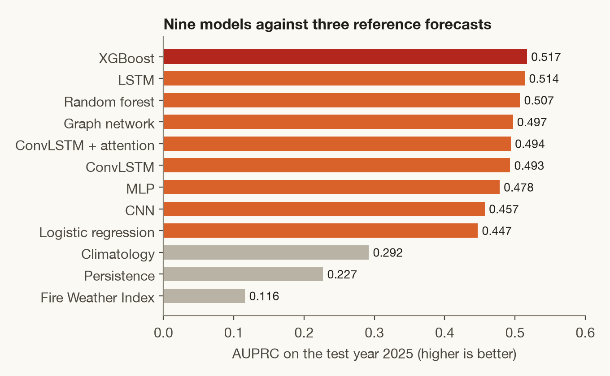
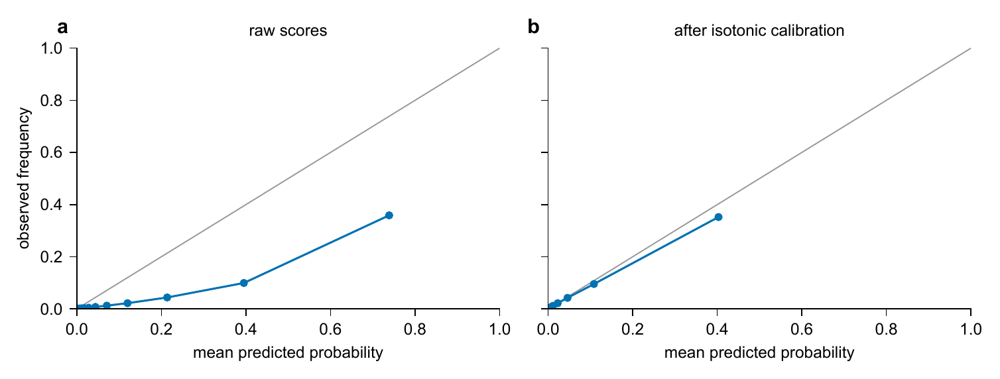
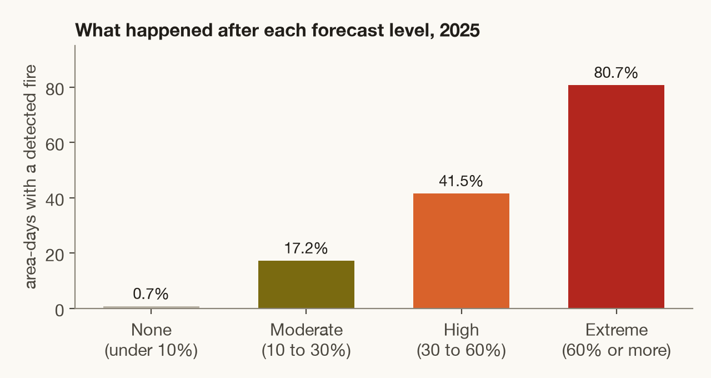
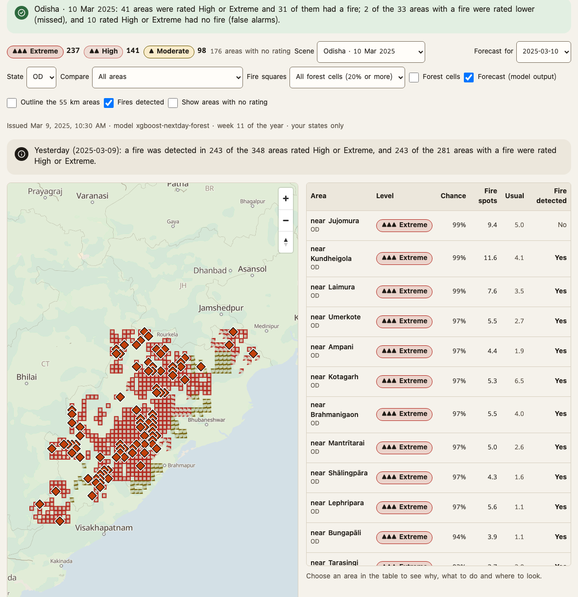
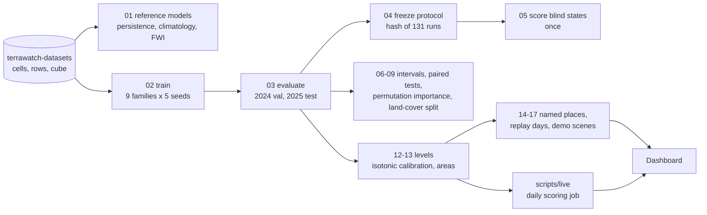

<div align="center">

# Next-day forest fire forecasting for India

**Will a satellite detect a fire in this forest cell tomorrow?**<br>
Nine model families, three reference forecasts, one frozen protocol, and the calibrated forecast that the [TerraWatch dashboard](https://github.com/Terra-Watch/dashboard) shows to rangers.

[**Dataset on Zenodo**](https://zenodo.org/records/23647151) &nbsp;·&nbsp; [Live site](https://terra-watch-tawny.vercel.app) &nbsp;·&nbsp; [Result tables](results/) &nbsp;·&nbsp; [Notebooks](notebooks/)




<sub>The test day of 2025 with the most forest detections. Left: the forecast issued the day before. Right: what the satellite detected.</sub>

</div>

---

## The task

| | |
|---|---|
| **Unit** | A cell-day: one 0.1 degree forest cell (about 11 km) on one UTC day |
| **Label** | A VIIRS fire detection inside forest in that cell on the next day, new or continuing, with false detections (kilns, mines, power plants) removed |
| **Where** | 7,148 forest cells in 17 states for training and testing; 526 cells in 3 blind states (Uttar Pradesh, West Bengal, Kerala) never used for training or model selection |
| **When** | 2019 to 2025. Train to 2023, validate on 2024, test on 2025 |
| **Inputs** | 41 per cell-day: fire history, ERA5-Land weather, the GFS forecast for the target day, NDVI, land cover, terrain, people and roads |
| **How rare** | 2.04% of the 2,574,304 test cell-days are positive |

Forest means land inside forest boundaries, not tree cover.

## Results

<table>
<tr>
<td width="56%" valign="top"></td>
<td width="44%" valign="top">

**Test year 2025**, mean of five seeds:

| Model | AUPRC | AUROC |
|---|---|---|
| **XGBoost** | **0.517** | 0.975 |
| LSTM | 0.514 | 0.974 |
| Random forest | 0.507 | 0.974 |
| Graph network | 0.497 | 0.970 |
| ConvLSTM + attention | 0.494 | 0.971 |
| Climatology | 0.292 | 0.941 |
| Persistence | 0.227 | 0.722 |
| Fire Weather Index | 0.116 | 0.887 |

The best models are within each other's intervals (XGBoost 0.417 to 0.572). Deep spatial models did not beat boosted trees on rows.

</td>
</tr>
</table>

**Three blind states, scored once after the models were frozen.** AUPRC: graph network 0.390, random forest 0.384, XGBoost 0.376, against 0.161 for persistence and 0.057 for climatology. The models carry over to states they never saw; climatology does not.

**What the model leans on.** Dropping fire history takes XGBoost from 0.517 to 0.398. Dropping the weather forecast costs 0.016, and weather, NDVI or land cover each cost less than that. Fire history alone reaches 0.443.

**New ignitions are harder.** On cells with no detection the day before, XGBoost reaches an AUPRC of 0.280 against 0.158 for climatology.

All tables: [`results/`](results/) (`all_runs.csv`, `per_state.csv`, `paired.csv`, `intervals.csv`, `blind/`, `extras/`). The 131 runs behind them are fixed by hash in `results/freeze.json`.

## From scores to the forecast a ranger reads

<table>
<tr>
<td width="50%" valign="top"></td>
<td width="50%" valign="top"></td>
</tr>
</table>

Raw scores are far too high (left). The dashboard therefore never shows them. `scripts/13_forecast_levels.py` fits an isotonic calibration of the five-seed mean on the 2024 validation year, groups cells into 0.5 degree areas (about 55 km) and cuts the chance into four levels at 10, 30 and 60%.

On 2025 the calibrated five-seed mean reaches an average precision of **0.519 per cell and 0.795 per area**, and the levels mean what they say (right): 81% of area-days rated Extreme had a detected fire, and 0.7% of those rated None.

<div align="center">
<br>
<sub>The forecast as the control room sees it, with what was detected.</sub>
</div>

## Pipeline



## Layout

| Path | Content |
|---|---|
| `src/wildfire_forecast/` | The library: `data` (loaders), `metrics`, `harness` (train and score one model), `neural_nets`, `reference_models`, `train` (job queues), `evaluate`, `freeze`, `score_blind`, `confidence_intervals`, `paired_tests`, `permutation_importance`, `landcover_split`, `risk_map`, `rescore_check` |
| `scripts/` | Numbered stages `01` to `17`, each a thin launcher for the module of the same name; `train_one_model.py` is called by the queues |
| `scripts/cloud/` | Shell jobs for the cloud machines (training, evaluation, blind scoring, extras) |
| `scripts/live/` | Building the live bundle and stores for the dashboard (see its README) |
| `notebooks/` | Nine notebooks that explain the data, `00` to `08`: detections, forest cells, weather, land cover, terrain, labels, the model input, the GFS forecast |
| `results/` | The final study tables, `freeze.json`, `blind/`, `extras/`, `run_manifests/` (the manifest of every run), `forecast_levels.json` |
| `tests/` | Unit tests |
| `runs/`, `runs_local/`, `live_state*/`, `bundle_inputs/` | Run outputs and live state (not tracked) |

## Run

The data comes from the sibling folder `../terrawatch-datasets/dataset/` (override with `WILDFIRE_DATA`). Download it from [Zenodo](https://zenodo.org/records/23647151).

```bash
make check                                           # compile every file, no data needed
make test                                            # unit tests, needs the dataset
python scripts/02_train_models.py cpu --out runs     # one stage; arguments are passed to the module
```

The blind states are scored once, after `04_freeze_protocol.py`:

```bash
WILDFIRE_FINAL=1 python scripts/05_score_blind_states.py
```

Exact package versions that produced the results: [`requirements.lock`](requirements.lock).

## What to keep in mind

- The label is a satellite detection, not a fire. Small fires and fires under cloud are missed, so a low chance is not proof of no fire.
- Almost half of the positive cell-days (45.4%) continue a fire detected the day before. That is why persistence is a fair reference and why new ignitions are reported separately.
- The forecast was less reliable in Himachal Pradesh, Sikkim and Uttarakhand in 2025, and the dashboard marks those states.
- The 2025 test year was looked at once for the levels after the study was frozen; that is reported, not hidden (`forecast_levels.json`, field `report`).

## Cite

Citation data is in [`CITATION.cff`](CITATION.cff). Code is MIT licensed; the dataset is CC BY 4.0.

---

<sub>Part of <a href="https://github.com/Terra-Watch">TerraWatch</a>: <a href="https://github.com/Terra-Watch/dashboard">dashboard</a> · <a href="https://github.com/Terra-Watch/fire-spread-model">spread outlook</a> · <a href="https://github.com/Terra-Watch/terrawatch-datasets">datasets</a> · <a href="https://github.com/Terra-Watch/acoustic-ml">sound classifier</a> · <a href="https://github.com/Terra-Watch/node-firmware">station firmware</a></sub>
