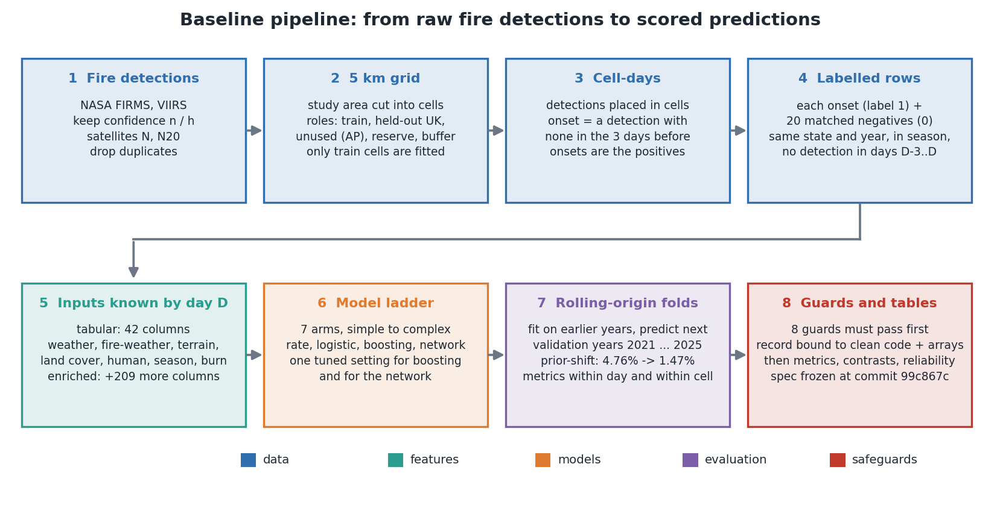
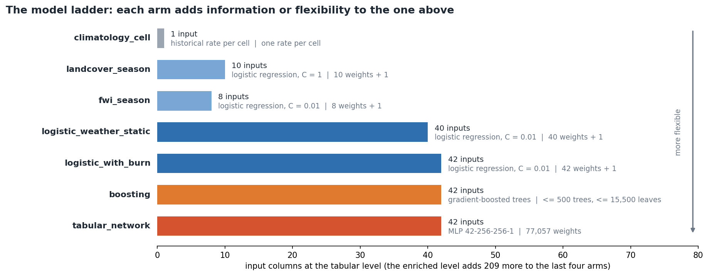
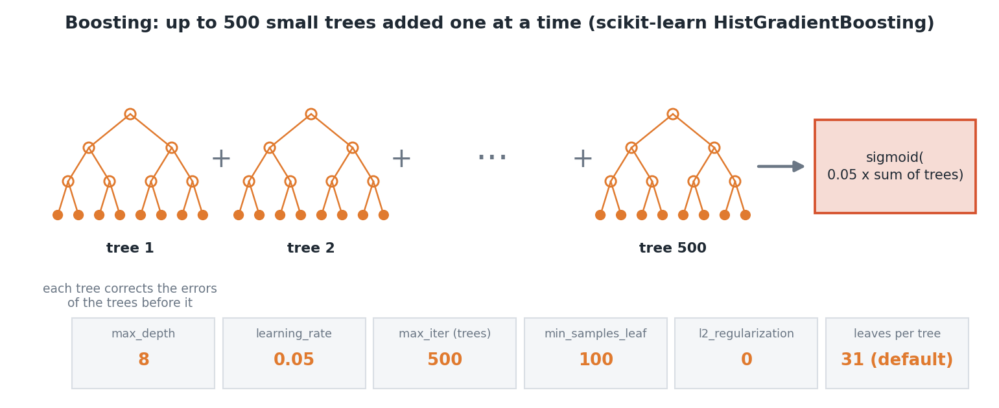
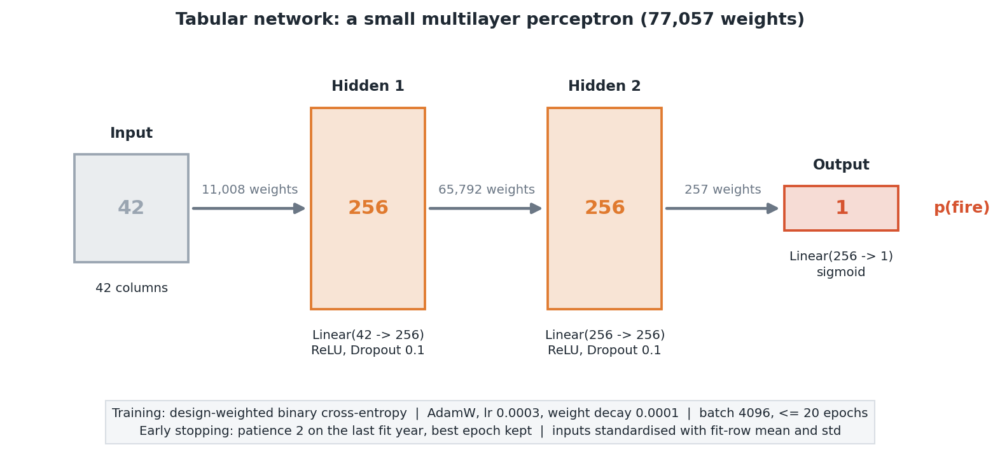
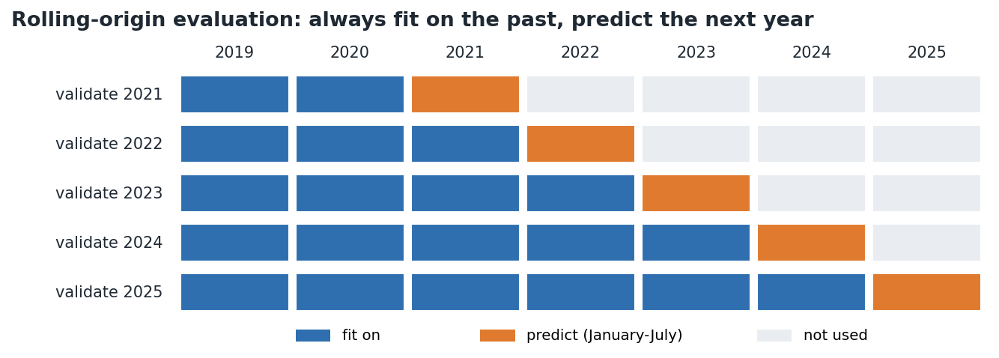

# Baseline architecture and parameters

The baseline has three parts: a data flow that builds labelled rows, a ladder of seven models fitted on them, and a fixed evaluation protocol. Figures are drawn by `docs/figures/draw_architecture.py`. Numbers come from `configs/*.yaml` and `artifacts/results/tuned.json`; weight counts are computed from the layer sizes.

## 1. Data flow

The target is the probability that a new fire starts in a forest cell on day D+1. About 1 row in 21 is positive, and reported probabilities are corrected from the sampled rate (4.76%) to the true rate (1.47%). The enriched level adds 209 columns to the 42 tabular ones, so it has 251 inputs.

## 2. The ladder of models

| Arm | Model | Tabular inputs | Fitted parameters |
|---|---|---|---|
| climatology_cell | historical fire rate of each cell | 1 | one rate per cell |
| landcover_season | logistic regression, C = 1 | 10 | 10 weights + intercept |
| fwi_season | logistic regression, C = 0.01 | 8 | 8 weights + intercept |
| logistic_weather_static | logistic regression, C = 0.01 | 40 | 40 weights + intercept |
| logistic_with_burn | logistic regression, C = 0.01 | 42 | 42 weights + intercept |
| boosting | histogram gradient-boosted trees | 42 | up to 500 trees, at most 15,500 leaves |
| tabular_network | multilayer perceptron | 42 | 77,057 weights |

The last four arms also run at the enriched level (251 inputs). Logistic arms standardise their inputs and use an L2 penalty (lbfgs, at most 300 iterations); the enriched logistic fit can reach that limit before converging.

## 3. The tuned settings
Tuning is a 12-trial random search per model on the rolling folds 2021-2024, with 600,000 training rows per fit. The winner is the lowest mean validation log loss (average precision breaks ties). 2025 takes no part in the choice.

### Boosting

| Setting | Chosen | Search space |
|---|---|---|
| max_depth | 8 | 4, 6, 8 |
| learning_rate | 0.05 | 0.05, 0.1 |
| max_iter (trees) | 500 | 200, 300, 500 |
| min_samples_leaf | 100 | 20, 100 |
| l2_regularization | 0 | 0, 1 |
| early stopping | off | fixed |
| leaves per tree | at most 31 (library default) | not searched |

### Network

| Setting | Chosen | Search space |
|---|---|---|
| width | 256 | 128, 256, 512 |
| depth (hidden layers) | 2 | 2, 3, 4 |
| dropout | 0.1 | 0.0, 0.1, 0.2 |
| learning_rate | 0.0003 | 0.001, 0.0003 |
| weight_decay | 0.0001 | 0.0001, 0.01 |
| optimiser, loss | AdamW, design-weighted binary cross-entropy | fixed |
| batch size, max epochs, patience | 4096, 20, 2 | fixed |

Weights: 11,008 + 65,792 + 257 = 77,057 at 42 inputs (130,561 at 251 inputs). Early stopping watches the loss on the last fit year and keeps the best epoch. The specification's default shape was depth 3; tuning picked depth 2.

## 4. Evaluation protocol

- **Metrics:** log loss, Brier score, average precision, AUC, top-k capture and lift, each reported across cells within a day and across days within a cell.
- **Frozen spec:** `configs/baseline.yaml` and `docs/baseline_spec.md` (commit 99c867c) cannot change after scoring starts.
- **Guards:** eight checks (including a label-shuffle AUC near 0.5) must pass, and a guard record bound to the clean tree and the array hashes is required before any score is written.
