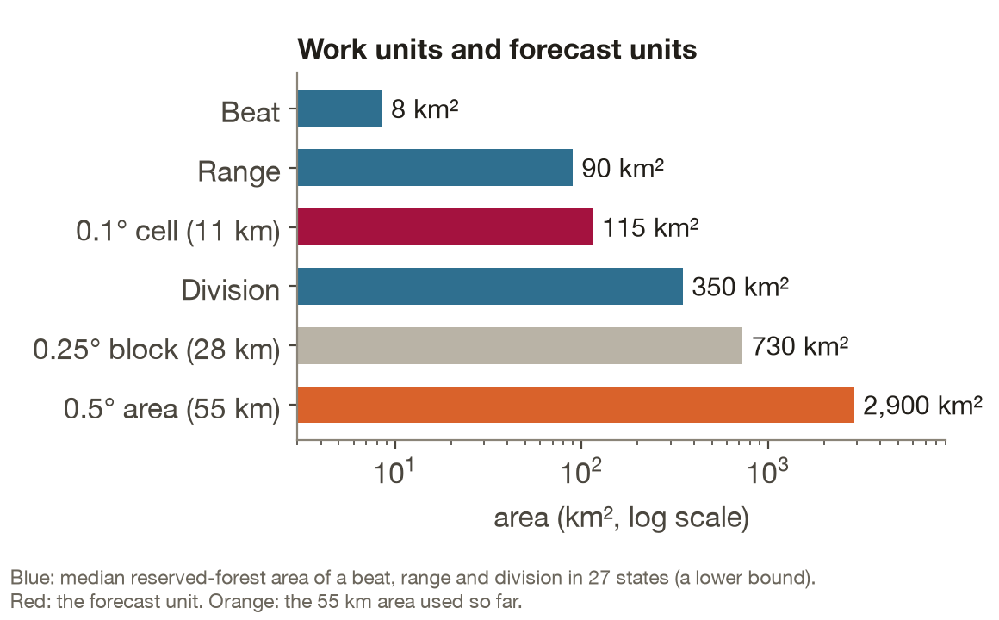
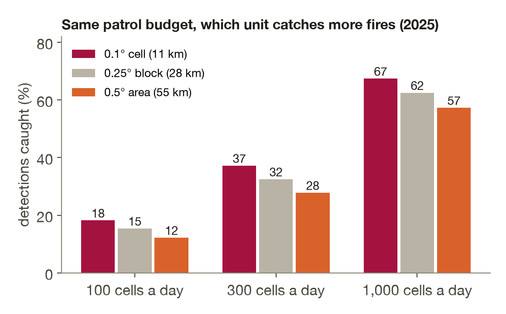
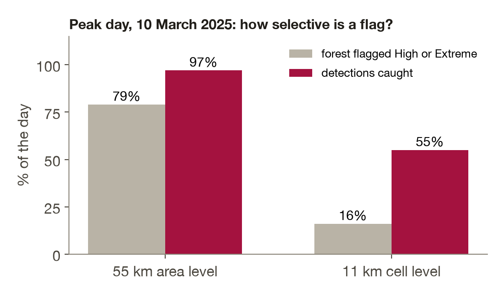

# Which unit should the forecast be shown at?

The model scores 0.1 degree forest cells (about 11 km, 7,148 cells). The dashboard also groups them into 0.5 degree areas (about 55 km). This study asks which of the two a forest department can act on, using the 2025 test year.

Reproduce: `python scripts/18_block_scale_study.py --runs runs --cells ../terrawatch-datasets/dataset/forest_all_gfs/cells.parquet --out results/block_scale_study` and `python scripts/19_admin_unit_sizes.py --rfa ../terrawatch-datasets/dataset/fsi_boundaries/Bharatmaps_RFA.parquet --out results/admin_unit_sizes.csv`.

## How big are the units a department works in

Computed from the Bharatmaps reserved-forest polygons (equal-area projection). Reserved-forest area only, so every figure is a lower bound on the real jurisdiction.

| Unit | Typical size (median) |
|---|---|
| Beat | about 8.5 km² |
| Range | about 90 km² |
| 0.1° cell (the model) | about 115 km² |
| Division | about 350 km² |
| 0.25° block | about 730 km² |
| 0.5° area | about 2,900 km² |

A cell is about one range. A 55 km area is eight divisions: nobody guards that as one unit.

## Result

Same predictions at three block sizes, compared at an equal patrol budget: the department can watch K forest cells a day, blocks are taken in order of mean cell chance, whole blocks only. Active days (50 or more detection cells): 97.

| Block | Average precision | Base rate lift | Calibration error | Fires caught at 100 / 300 / 1000 cells a day |
|---|---|---|---|---|
| 0.1° cell | 0.51 | 25.2 | 0.0024 | 18% / 37% / 67% |
| 0.25° | 0.70 | 15.8 | 0.0025 | 15% / 33% / 63% |
| 0.5° | 0.79 | 10.5 | 0.0023 | 12% / 28% / 57% |

- At equal watched cells the cell level catches more fires. Difference to the 55 km blocks: +6.0, +9.3 and +10.2 points at 100, 300 and 1000 cells (95% intervals exclude 0; resampled by whole ISO week, 15 weeks, because consecutive days are not independent; `results/block_scale_study_diffs.csv`).
- Average precision is higher for big blocks only because their base rate is higher. Relative to the base rate (lift) the cell level is best.
- Calibration holds at every size.
- On the busiest day the 55 km High or Extreme level flags about 79% of forest cells with 14% precision, the cell level 16% with 41%.

## Decision

Two scales, two actions. The 55 km area is a broad, cheap warning for planning. The 11 km cell is where patrols are sent: the dashboard shows the forest land of the top cells, with their own calibrated chance, and outlines the forest (clipped to the forest boundaries) so towns, villages and fields inside the square are not shaded.

## Limits to state openly

- Unit sizes are reserved-forest lower bounds; 27 states name divisions.
- Blind-state predictions are not stored locally, so the study covers the states the model trained on.
- Top cell-level chances slightly over-predict (66% observed against 74% predicted at the highest levels).
- Fires are satellite detections, not ground truth for ignition.

## Questions a panel may ask

- **"Why not just show 11 km?"** We do, for patrols. The area level stays as the summary because a state officer cannot read 7,000 cells.
- **"Your 55 km AP was higher."** Base rate. Lift and equal-budget recall favour the cell.
- **"Can a ranger guard 11 km?"** A cell is about one range (115 km² against 90 km²); a beat is 8.5 km², so the cell tells a range officer which beats to check first.
- **"Is the chance trustworthy at cell level?"** Calibration error 0.0024 on 2025, fitted on 2024.
